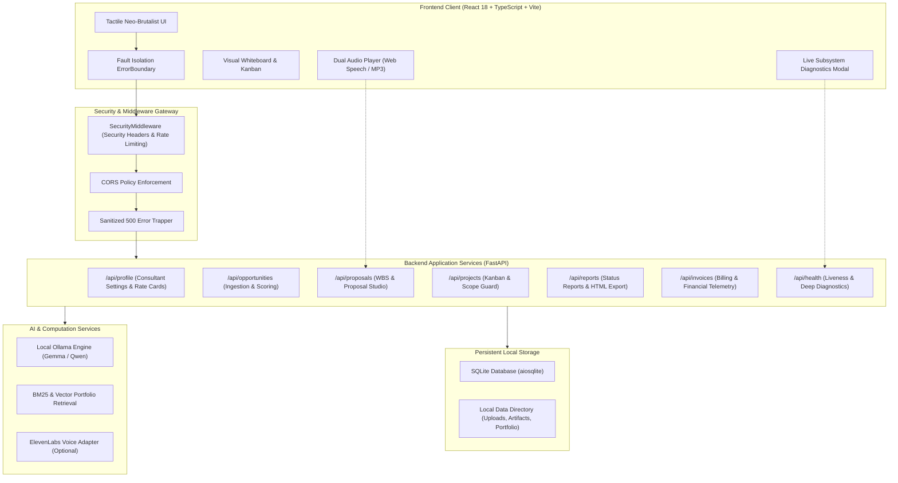

# FreelanceCanvas

> **Autonomous AI Workstation for Independent Software Engineers, Technical Consultants, and Boutique Agencies**  
> *"Accurate scoping, automated scope-creep protection, and streamlined milestone invoicing with zero unbillable friction."*

[](https://python.org)
[](https://fastapi.tiangolo.com)
[](https://react.dev)
[](https://www.typescriptlang.org)
[](https://vitejs.dev)
[](https://opensource.org/licenses/MIT)
[](https://github.com/TejasRawool186/FreelanceCanvas)

---

## Executive Overview

FreelanceCanvas is an open-source, local-first operational desk engineered specifically for solo software engineers, consultants, and boutique agencies. It transforms unstructured client RFP documents and project briefs into defensible, mathematically grounded commercial proposals, tracks project execution on an interactive Kanban board with proactive scope-creep detection, and streamlines milestone invoicing.

### Local-First Architecture

* **Zero Mandatory Paid Subscriptions**: Operates fully out-of-the-box without requiring external proprietary API keys.
* **Deterministic Fallback Engines**: Structural extraction, 5-factor scoring, and Work Breakdown Structure (WBS) calculations compute with mathematical determinism when offline.
* **Dual Audio Synthesis**: High-fidelity neural voice synthesis via ElevenLabs with automated fallback to the browser's native Web Speech API (`window.speechSynthesis`).
* **Complete Fault Isolation**: Production-grade React error boundaries and sanitized server error handling prevent cascading application failures.

---

## System Architecture



---

## Core Capabilities

| Capability | Module | Description |
| :--- | :--- | :--- |
| **Profile & Rate Card Management** | Consultant Identity | Multi-user profile management (`/api/profile`), custom rate cards, currency configurations, and technical skill taxonomy without hardcoded credentials. |
| **Document Ingestion & Sanitization** | Brief Parser | Robust parsing across PDF, Markdown, and Plain Text with file signature validation, size limits (10 MB), and security sanitization. |
| **AI Opportunity Intelligence** | Requirements Extractor | Structured extraction (core objectives, functional and non-functional requirements, key deliverables) and explainable 5-factor scoring (0 to 100). |
| **Portfolio & Evidence RAG** | Retrieval Engine | Case study matching using BM25 and vector embeddings to substantiate client proposals with past production deliverables. |
| **Scoping & Estimation Engine** | WBS Calculator | Formulaic Work Breakdown Structure (`hours * rate + contingency`), 3 commercial billing models (Fixed Price, Time & Materials, Retainer), and risk register. |
| **Proposal Studio & Export** | Document Studio | Tri-mode editing (Markdown, Split View, Live Preview), lifecycle transitions (`draft` -> `ready` -> `sent` -> `accepted`), and vector-clean standalone HTML export. |
| **Project Kanban Workspace** | Delivery Board | Direct proposal promotion to active projects, milestone task decomposition, actual vs. estimated hour logging, and visual Kanban columns. |
| **Scope Guard Sentinel** | Change Order Sentinel | Semantic similarity analysis on incoming client requests to flag out-of-scope work and draft formal change orders before delivery slips. |
| **Client Communications Hub** | Status Reporting | Automated sprint status reports, milestone sign-offs, blocker alerts, and exportable standalone HTML client progress reports. |
| **Financials & Invoicing Hub** | Billing Engine | Automated milestone billing, unbilled timesheet invoicing, yield tracking, receivables aging, and printable standalone HTML invoices. |
| **Audio Briefings** | Voice Synthesis | Opportunity audio briefs streaming MP3 audio via ElevenLabs, with zero-dependency offline fallback via browser Web Speech synthesis. |
| **Security & Diagnostics** | Telemetry Gateway | HSTS, CSP, and X-Frame-Options headers, token-bucket rate limiting on heavy AI endpoints, live database ping, disk write checks, and diagnostics UI. |

---

## Technology Stack

### Backend
* **Runtime**: Python 3.12+
* **Framework**: FastAPI (Asynchronous ASGI)
* **Database**: SQLite via `aiosqlite` and SQLAlchemy
* **AI & NLP**: LangChain, Local Ollama, BM25, Qdrant Vector Store
* **Voice**: ElevenLabs API with graceful fallback to browser-native Web Speech API
* **Document Processing**: `pypdf`, `python-multipart`

### Frontend
* **Runtime**: Node.js 20+
* **Framework**: React 18 with TypeScript 5.5
* **Build System**: Vite 5.4
* **Icons & Styling**: Lucide React, Custom Neo-Brutalist CSS System
* **Markdown**: `react-markdown`, `remark-gfm`
* **HTTP Client**: Axios with unified error handling and request interception

---

## Quick Start Guide

### Option 1: Docker Deployment (Recommended)

1. **Clone the repository**:
   ```bash
   git clone https://github.com/TejasRawool186/FreelanceCanvas.git
   cd FreelanceCanvas
   ```

2. **Configure environment variables**:
   ```bash
   cp .env.example .env
   ```

3. **Launch the container stack**:
   ```bash
   docker compose up --build
   ```
   * Open `http://localhost:8010` in your web browser.

> **Local Ollama Integration**: To run with an accompanying containerized Ollama instance:
> ```bash
> docker compose --profile with-ollama up --build
> ```

---

### Option 2: Local Native Setup

#### Backend Setup (Python 3.12+)

```bash
# 1. Create a virtual environment
python -m venv venv

# 2. Activate the virtual environment
# Windows:
.\venv\Scripts\activate
# Linux/macOS:
source venv/bin/activate

# 3. Install backend dependencies
pip install -r requirements.txt

# 4. Start the backend server (Port 8010)
python scripts/run_backend.py
```

#### Frontend Setup (Node 20+)

```bash
# 1. Navigate to frontend directory
cd frontend

# 2. Install dependencies
npm install

# 3. Start development server with proxy
npm run dev
```
* Access the interactive development workstation at `http://localhost:5173`.

---

## Verification & Testing

FreelanceCanvas includes comprehensive automated unit, integration, and end-to-end journey tests covering all application modules.

### Running Backend Test Suite

```bash
python -m pytest tests/ -v
```

Expected result:
```
====================== 54 passed in 30.00s ======================
```

### Running Frontend Compilation & Bundle Verification

```bash
cd frontend
npm run build
```

Expected result:
```
vite v5.4.x building for production...
built in 3.8s
```

---

## API Endpoints Reference

| Method | Path | Description |
| :--- | :--- | :--- |
| `GET` | `/api/health` | Subsystem liveness and diagnostics telemetry |
| `GET` | `/api/profile` | Retrieve consultant identity and rate card configuration |
| `PUT` | `/api/profile` | Update profile settings and commercial rates |
| `POST` | `/api/opportunities` | Ingest and parse RFP / project brief documents |
| `GET` | `/api/opportunities` | List all tracked opportunities and scores |
| `POST` | `/api/opportunities/{id}/analyze` | Execute AI intelligence and 5-factor scoring |
| `GET` | `/api/proposals` | List commercial proposals |
| `POST` | `/api/proposals` | Generate structured proposal from opportunity |
| `GET` | `/api/proposals/{id}/audio` | Stream or generate synthesized audio briefing |
| `POST` | `/api/projects` | Promote accepted proposal to active execution project |
| `GET` | `/api/projects/{id}/tasks` | Retrieve project Kanban tasks and hour logs |
| `POST` | `/api/projects/{id}/scope-guard` | Analyze client request against baseline scope |
| `POST` | `/api/projects/{id}/reports` | Generate client weekly or milestone status report |
| `GET` | `/api/invoices` | List invoices and financial health metrics |
| `POST` | `/api/invoices/auto/milestone` | Generate invoice from completed project milestone |

---

## Environment Configuration

Configuration variables defined in `.env.example`:

| Variable | Default Value | Description |
| :--- | :--- | :--- |
| `HOST` | `0.0.0.0` | Bind address for application server |
| `PORT` | `8010` | Port for FastAPI and static asset delivery |
| `DEBUG` | `false` | Verbose debug logging switch |
| `ALLOWED_ORIGINS` | `http://localhost:5173,...` | Whitelist for secure CORS preflight checks |
| `RATE_LIMIT_ENABLED` | `true` | Rate limiting protection switch |
| `RATE_LIMIT_AI_BURST` | `20` | Max requests per minute on compute-heavy routes |
| `DATABASE_URL` | `sqlite+aiosqlite:///data/freelance_desk.db` | Async database connection string |
| `OLLAMA_BASE_URL` | `http://localhost:11434` | Endpoint for local LLM inference |
| `OLLAMA_MODEL` | `gemma3:1b` | Target local model (`gemma3:1b`, `qwen2.5:1.5b`) |
| `ELEVENLABS_API_KEY` | *(Optional)* | API key for ElevenLabs neural audio synthesis |
| `SERPAPI_API_KEY` | *(Optional)* | API key for client web reconnaissance |

---

## Project Structure

```
FreelanceCanvas/
├── backend/
│   ├── app/
│   │   ├── agent/           # Estimation, intelligence, reporting, and scope guard
│   │   ├── api/             # FastAPI routers (opportunities, proposals, projects, invoices)
│   │   ├── middleware/      # Security headers, rate limiting, and error sanitization
│   │   ├── models/          # SQLAlchemy async data models
│   │   ├── schemas/         # Pydantic request/response validation schemas
│   │   ├── tools/           # Audio generation, document parsing, portfolio RAG
│   │   ├── config.py        # Centralized settings and environment validation
│   │   ├── database.py      # Async SQLite session management
│   │   └── main.py          # Application entrypoint and static mount
│   └── tests/               # Pytest suite covering all 14 lifecycle modules
├── frontend/
│   ├── src/
│   │   ├── components/      # UI components (Kanban, Scoping, Invoicing, Audio, Modals)
│   │   ├── App.tsx          # Workspace navigation and state management
│   │   ├── index.css        # Neo-brutalist tactile design system tokens
│   │   ├── main.tsx         # Application root with ErrorBoundary wrapper
│   │   └── types.ts         # TypeScript interfaces and domain models
│   ├── package.json         # Frontend dependencies and build scripts
│   └── vite.config.ts       # Vite build and proxy configuration
├── data/                    # Persistent storage (SQLite DB, portfolio store, artifacts)
├── docs/                    # Architecture diagrams and specifications
├── scripts/                 # Utility runners and initialization scripts
├── Dockerfile               # Multi-stage production container build
├── docker-compose.yml       # Production container orchestration
├── pytest.ini               # Pytest configuration
└── README.md                # Project documentation
```

---

## Contributing

Contributions from software engineers, consultants, and open-source contributors are welcome.

1. Fork the repository on GitHub.
2. Create a feature branch (`git checkout -b feat/feature-name`).
3. Ensure all backend tests pass (`python -m pytest tests/`).
4. Ensure frontend build passes (`npm run build`).
5. Commit your changes following [Conventional Commits](https://www.conventionalcommits.org).
6. Push to your branch and submit a Pull Request.

---

## License

This project is licensed under the **MIT License**. You are free to use, modify, and distribute it in private or commercial consulting practices.
